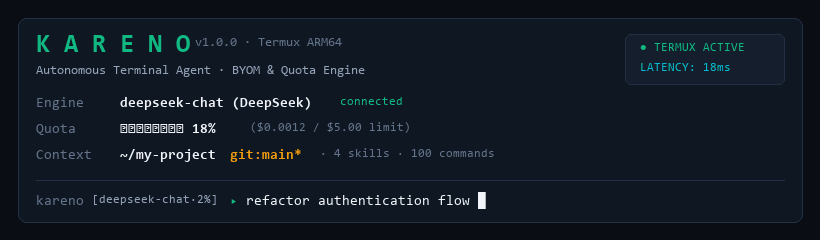

<div align="center">



# KARENO

**Ultra-Lightweight Autonomous Terminal Coding Agent for Termux & Desktop CLI**

`Node.js Native` · `Zero External Dependencies` · `Bring Your Own Model (BYOM)` · `Quota Gatekeeper` · `Skills Ecosystem` · `100 Slash Commands`

</div>

---

## Overview

**KARENO** is a lightweight, high-velocity autonomous coding agent built in pure Node.js for **Termux (Android ARM64)** and desktop terminals (Linux, macOS, Windows).

Unlike bloated CLI wrappers that bundle hundreds of megabytes of dependencies or rely on fragile "free model" web scrapers, KARENO is engineered around four strict principles:

1. **Bring Your Own Model (BYOM) Only**: Connect your own API keys or local endpoints across **DeepSeek**, **Anthropic Claude**, **OpenAI**, **Groq LPU**, **Google Gemini**, **OpenRouter**, or **Local Ollama**.
2. **Hard Quota & Budget Management**: Built-in token telemetry, daily/session token caps, daily USD spend limits, rate-limit (RPM) enforcement, and a live quota gauge (`▰▰▱▱▱▱▱▱`) in your prompt spine.
3. **Modular Skills Ecosystem (`SKILL.md`)**: Install, create, toggle, and export domain-specific `SKILL.md` modules from GitHub repositories, remote URLs, or local directories.
4. **Original Kareno Tactical Spine UI**: Purpose-built asymmetric angular terminal interface (`┏━⟦ ... ⟧`, `╟──▸`, `┗━━▸`) that adapts dynamically to narrow Termux mobile viewports (56 to 88 columns) with zero visual clutter.

---

## Quick Start (Termux & Linux / macOS / Windows)

### 1. Termux (Android) Installation

```bash
pkg update -y && pkg install -y nodejs git
git clone https://github.com/demonala/KarenoSecurityMAX-.git kareno
cd kareno
chmod +x install-termux.sh
./install-termux.sh
```

Or run directly without linking:

```bash
node bin/kareno.js
```

### 2. Desktop (Windows / Linux / macOS)

```bash
git clone https://github.com/demonala/KarenoSecurityMAX-.git kareno
cd kareno
node bin/kareno.js
```

On Windows, you can also double-click `start.bat` or link globally with `npm link`.

---

## Connecting Your Own Model (BYOM)

KARENO does not include free/scraped models. You control your own model provider, API key, and token spend:

```text
┏━⟦KARENO⟧━⟦DEEPSEEK:deepseek-chat⟧━⟦▱▱▱▱▱ 0% $0.0000⟧━⟦kareno⟧
┗━━▸ /provider:set deepseek
┗━━▸ /key:set sk-your-api-key-here
┗━━▸ /model:set deepseek-chat
```

### Supported Providers Out of the Box

| Provider ID | Provider Name | Default Model | Environment Variable Fallback |
| :--- | :--- | :--- | :--- |
| `deepseek` | DeepSeek API | `deepseek-chat` | `DEEPSEEK_API_KEY` |
| `anthropic` | Anthropic Claude | `claude-3-7-sonnet-latest` | `ANTHROPIC_API_KEY` |
| `openai` | OpenAI | `gpt-4o` | `OPENAI_API_KEY` |
| `groq` | Groq Cloud (LPU) | `llama-3.3-70b-versatile` | `GROQ_API_KEY` |
| `gemini` | Google Gemini | `gemini-2.5-pro` | `GEMINI_API_KEY` |
| `openrouter` | OpenRouter | `anthropic/claude-3.7-sonnet` | `OPENROUTER_API_KEY` |
| `ollama` | Local Ollama (Self-Hosted) | `qwen2.5-coder:7b` | `OLLAMA_API_KEY` (Optional) |

You can also point KARENO to any custom OpenAI-compatible proxy or vLLM server via `/endpoint <url>`.

---

## Quota & Budget Gatekeeper

Every model call passes through `QuotaManager` (`src/quota.js`) before execution and records exact input/output token counts and USD cost afterward:

* `/quota` : Display visual quota gauge, daily tokens, session tokens, and USD spend.
* `/quota:set <tokens>` : Set hard daily token ceiling (blocks requests once reached).
* `/quota:session <tokens>` : Set maximum token allowance for the current session.
* `/budget <usd>` : Set maximum daily USD spend cap (e.g., `/budget 2.50`).
* `/rate <rpm>` : Set maximum requests-per-minute limit.
* `/cost:estimate <file>` : Calculate token count and estimated USD cost of reading a file before sending it to the model.

---

## Skills System (`SKILL.md`)

KARENO loads skills from three layers:
1. **Bundled Core Skills** (`skills/`): `termux-ops`, `security-audit`, `clean-arch`, `perf-tuning`
2. **User Global Skills** (`~/.kareno/skills/<name>/SKILL.md`)
3. **Workspace Skills** (`.kareno/skills/<name>/SKILL.md`)

Manage skills directly from the CLI:

```text
/skills                                  # List all installed skills and ON/OFF state
/skill:install owner/repo                # Install a SKILL.md directly from GitHub
/skill:install ./path/to/SKILL.md        # Install a local skill file
/skill:create rust-embedded              # Scaffold a new custom skill in ~/.kareno/skills/
/skill:enable security-audit             # Activate a skill in the system prompt
/skill:disable perf-tuning               # Deactivate a skill to save context tokens
```

---

## All 100 Native Slash Commands

KARENO ships with **100 verified slash commands** across 10 engineering domains:

### 01. Core Session & System (10)
| Command | Description |
| :--- | :--- |
| `/help` | Display categorized command reference |
| `/commands` | List all 100 Kareno slash commands |
| `/status` | Show full system, model, quota, and skill telemetry |
| `/clear` | Clear terminal screen and reset conversation history |
| `/reset` | Factory reset current session state and context buffer |
| `/version` | Display Kareno engine version and Node.js V8 build |
| `/doctor` | Run diagnostic checks on Termux, Node, Git, keys, and permissions |
| `/config` | View active configuration from `~/.kareno/config.json` |
| `/history` | View conversation turn history for this session |
| `/exit` | Terminate Kareno session cleanly |

### 02. BYOM Model & Provider Engine (12)
| Command | Description |
| :--- | :--- |
| `/model` | Show current active model and provider |
| `/model:set` | Set active model ID (e.g. `/model:set deepseek-chat`) |
| `/model:list` | List all supported providers and recommended models |
| `/provider` | Show current active API provider |
| `/provider:set` | Switch provider (`deepseek`, `anthropic`, `openai`, `groq`, `gemini`, `openrouter`, `ollama`) |
| `/key:set` | Save API key for current provider (`/key:set <api_key>`) |
| `/key:rm` | Remove stored API key for current provider |
| `/key:list` | List configured provider keys (masked for security) |
| `/endpoint` | Set custom OpenAI-compatible base URL (`/endpoint <url>`) |
| `/temp` | Set generation temperature `0.0` to `2.0` (`/temp 0.2`) |
| `/max-tokens` | Set max completion tokens per turn (`/max-tokens 4096`) |
| `/ping` | Ping active model provider to verify auth and latency |

### 03. Quota, Budget & Rate Management (10)
| Command | Description |
| :--- | :--- |
| `/quota` | Display live token quota gauge, daily usage, and session limits |
| `/quota:set` | Set daily token hard limit (`/quota:set 500000`) |
| `/quota:session` | Set per-session token limit (`/quota:session 100000`) |
| `/quota:reset` | Reset daily and session token counters to zero |
| `/budget` | Set daily USD spend cap (`/budget 5.00`) |
| `/cost` | View detailed USD cost breakdown by session, day, and lifetime |
| `/usage` | Show token usage telemetry split by provider |
| `/rate` | Set max requests-per-minute limit (`/rate 30`) |
| `/tokens` | Count approximate tokens in active conversation context |
| `/cost:estimate` | Estimate token count and USD cost for a file (`/cost:estimate <file>`) |

### 04. Skills Ecosystem (10)
| Command | Description |
| :--- | :--- |
| `/skills` | List all installed skills (bundled, user, and workspace) |
| `/skill:install` | Install skill from local path, URL, or GitHub `owner/repo` |
| `/skill:remove` | Uninstall a user-installed skill (`/skill:remove <name>`) |
| `/skill:enable` | Activate a skill for autonomous agent turns |
| `/skill:disable` | Deactivate a skill to save context tokens |
| `/skill:info` | Inspect full metadata and instructions of a skill |
| `/skill:create` | Scaffold a new custom `SKILL.md` (`/skill:create <name>`) |
| `/skill:reload` | Rescan skill directories and reload `SKILL.md` definitions |
| `/skill:dir` | Print paths to user and bundled skill directories |
| `/skill:export` | Export a skill's `SKILL.md` to current directory |

### 05. Workspace & File Operations (10)
| Command | Description |
| :--- | :--- |
| `/ls` | List files and directories in workspace (`/ls [dir]`) |
| `/tree` | Render recursive directory tree structure |
| `/read` | Read file contents with line numbers (`/read <file>`) |
| `/write` | Write text to a file (`/write <file> <content>`) |
| `/stat` | Inspect file size, timestamps, and permissions |
| `/find` | Find files by name pattern across workspace |
| `/grep` | Search code for regex or literal string (`/grep <query>`) |
| `/touch` | Create an empty file or update timestamp |
| `/mkdir` | Create directory recursively (`/mkdir <dir>`) |
| `/rm` | Remove a file from workspace (`/rm <file>`) |

### 06. AI Code Engineering & Analysis (10)
| Command | Description |
| :--- | :--- |
| `/plan` | Generate an architectural implementation plan for a task |
| `/review` | Run an automated code review on a file or git diff |
| `/explain` | Explain how a file or function works in detail |
| `/refactor` | Refactor a target file for clarity and modularity |
| `/optimize` | Optimize a file for speed and low memory usage |
| `/fix` | Diagnose and repair bugs in a specified file |
| `/types` | Generate or tighten TypeScript/JSDoc type annotations |
| `/deps` | Analyze `package.json` or project dependencies |
| `/complexity` | Calculate line, function, and branch complexity metrics |
| `/doc` | Generate technical documentation for a file |

### 07. Git & Version Control (10)
| Command | Description |
| :--- | :--- |
| `/git` | Run any git subcommand (`/git <args>`) |
| `/git:status` | Show compact git working tree status |
| `/diff` | Display unstaged git changes |
| `/log` | Show recent git commit history graph |
| `/commit` | Stage all changes and commit with message (`/commit <msg>`) |
| `/branch` | List or create git branches |
| `/checkout` | Switch branches or restore working tree files |
| `/stash` | Stash or pop local modifications |
| `/blame` | Show line-by-line commit annotations for a file |
| `/undo` | Discard unstaged changes in a specific file (`/undo <file>`) |

### 08. Execution, Termux & Runtime (10)
| Command | Description |
| :--- | :--- |
| `/run` | Execute a shell command in workspace (`/run <cmd>`) |
| `/test` | Run project test suite (`npm test` or custom command) |
| `/build` | Run project build pipeline |
| `/bench` | Benchmark execution time of a command in milliseconds |
| `/env` | List safe environment variables and runtime paths |
| `/ps` | Show running processes |
| `/pwd` | Print current working directory |
| `/cd` | Change current working directory (`/cd <dir>`) |
| `/sysinfo` | Display CPU, RAM, OS, and architecture telemetry |
| `/termux` | Inspect Termux Android environment, prefix, and storage status |

### 09. Context, Memory & Checkpoints (9)
| Command | Description |
| :--- | :--- |
| `/context` | Show active context window utilization and pinned files |
| `/compact` | Compress conversation history to save token quota |
| `/pin` | Pin a file into persistent system prompt context (`/pin <file>`) |
| `/unpin` | Unpin a file from persistent context (`/unpin <file>`) |
| `/pins` | List all currently pinned workspace files |
| `/remember` | Save a persistent project note or rule (`/remember <note>`) |
| `/forget` | Remove a saved memory note by index (`/forget <index>`) |
| `/memories` | List all persistent memory notes |
| `/checkpoint` | Save a named snapshot of current conversation (`/checkpoint <id>`) |
| `/restore` | Restore a saved conversation checkpoint (`/restore <id>`) |

### 10. Security, Crypto & Network Utilities (9)
| Command | Description |
| :--- | :--- |
| `/audit` | Scan workspace files for dangerous patterns (`eval`, `exec`, injections) |
| `/secrets` | Scan codebase for accidentally hardcoded API keys or tokens |
| `/hash` | Compute SHA-256, SHA-512, and MD5 of a file or string |
| `/base64:enc` | Encode string to Base64 |
| `/base64:dec` | Decode Base64 string to UTF-8 |
| `/hex` | Encode string to hexadecimal representation |
| `/uuid` | Generate a cryptographically random v4 UUID |
| `/json:fmt` | Validate and pretty-format a JSON file |
| `/ip` | Display local network interfaces and IPv4/IPv6 addresses |
| `/export` | Export session transcript to a Markdown report (`/export [file]`) |

---

## License

MIT License · Absolute Immortal Inc.
